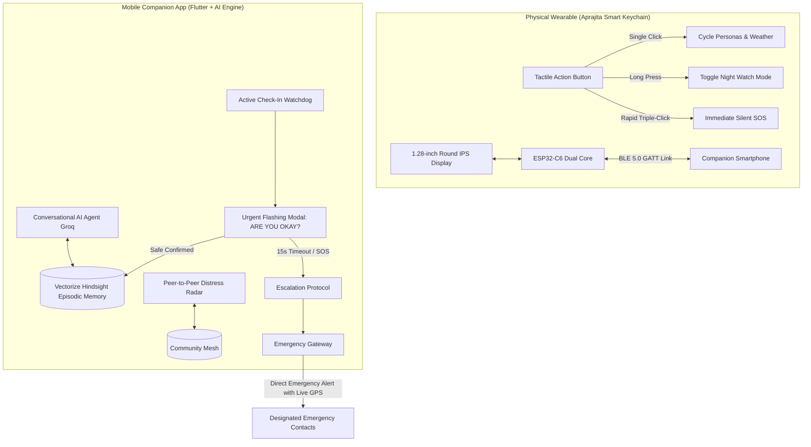

# Aprajita — AI-Powered Lifestyle Companion & Autonomous Personal Guardian

Aprajita is a hybrid hardware-and-mobile personal safety system designed for everyone—daily commuters, solo runners, students, shift workers, and elderly family members. It transforms personal safety from an awkward, reactive panic button into an expressive Everyday Carry (EDC) lifestyle smart keychain.

Beneath its animated round display and lifestyle personas lies an autonomous defense architecture: physical multi-click interrupt triggers, low-latency BLE telemetry, peer-to-peer distress meshing, and an intelligent safety companion grounded in **Vectorize Hindsight** episodic long-term memory.

---

## 🏛️ System Architecture

Aprajita operates across two interconnected domains: a physical smart keychain wearable and a mobile smartphone companion application.



> **Hardware Communication Note:** The current production release uses a cloud cellular gateway (Twilio) to handle instant emergency SMS and automated voice dispatch with live Google Maps telemetry. The next hardware iteration integrates dedicated onboard GNSS positioning and direct cellular SIM/GSM modules directly onto the PCB for 100% phone-independent standalone transmission.

---

## ⚡ Core Subsystems & Technical Capabilities

### 1. Episodic Long-Term Memory Engine (Vectorize Hindsight)
Standard LLMs suffer from severe amnesia and cannot reliably manage safety check-ins or emergency protocols. Aprajita integrates **Vectorize Hindsight** to give the companion long-term episodic vector memory across three primitives:
* **Retain**: Every check-in preference, route corridor, emergency contact priority, and past incident timeline is ingested into the user's private episodic memory bank.
* **Recall**: Queries vector memory before answering, strictly grounding the agent in verified facts (preventing hallucination of contact names, phone numbers, or escalation rules).
* **Reflect**: Synthesizes cross-temporal longitudinal patterns across incidents and device diagnostics, preventing repetitive troubleshooting suggestions when hardware connection drops occur.

### 2. Conversational Safety Watchdog & Flashing Check-In Modal
* **Dynamic Natural Language Parser**: Extracts check-in durations from conversational phrases (*"Check on me in 10 minutes"*, *"Watch over me for 15 seconds"*, *"Remind me in 5"*).
* **Deterministic Runtime Watchdog**: Immediately decouples the timer from the LLM, arming an active background countdown in the client.
* **High-Impact Check-In Screen**:
  * When the timer expires, an unmissable full-screen alert dialog flashes with a pulsing crimson border and repeating haptic vibration pulses.
  * Prompts: **"ARE YOU OKAY? Any troubles or need assistance?"**
  * **15-Second Grace Countdown**:
    * **`I AM OKAY / SAFE ✅`**: Dismisses alert, logs safe confirmation streak to Hindsight memory bank.
    * **`I NEED HELP! (SOS) 🚨`** or **Timer Expiration**: Automatically triggers emergency escalation, capturing live GPS fix and dispatching urgent alerts to primary contacts.

### 3. Tactile Multi-Click Hardware State Machine
* **ESP32-C6 30ms Debounced GPIO Interrupts**:
  * **Single Click**: Seamlessly cycles display dashboards (Animated Moods $\rightarrow$ Live Weather $\rightarrow$ Night Watch Mode $\rightarrow$ System Battery/Signal Telemetry).
  * **Long Press**: Toggles autonomous Night Watch mode on or off.
  * **Triple Click (<380ms)**: Discreet, silent emergency trigger that dispatches an immediate distress beacon without alerting an aggressor.
* **Visual Expression Engine**:
  * Drives a 240×240 circular GC9A01 IPS LCD with fluid expressive face animations (Happy, Alert, Curious, Sleepy, Focused).
  * Supports real-time custom GIF and animation streaming over Bluetooth LE.

### 4. Autonomous Night Watch Mode & Stagnation Detection
* **Periodic Breadcrumb Telemetry**: Automatically broadcasts location updates at regular 10-minute intervals while traveling through unfamiliar transit zones or late-night corridors.
* **Stagnation Anomaly Detection**: If position coordinates remain motionless ($<15\text{m}$) for $>10$ minutes in an unscheduled area, the system flags an anomaly and initiates an urgent check-in sequence.

### 5. Peer-to-Peer Community Radar
* **Spherical Geofencing (Haversine)**: Calculates distances between an alert beacon and verified community responders within a 1 km to 10 km radius.
* **Rapid Civilian Assistance**: Alerts local volunteers for immediate physical intervention before first responders can reach the scene.

### 6. Screen-Off Physical Volume Trigger
* **Quad-Click Volume Pattern**: Native Android keystroke listeners intercept physical volume button presses. Four rapid clicks within 2.5 seconds initiate the emergency sequence without requiring the user to unlock or look at the screen.

---

## 📁 Repository Directory Structure

```
├── aprajita_app/                          # Flutter Mobile Application
│   ├── android/                          # Android native project & permissions
│   ├── assets/                           # Branding assets, logos, and vector icons
│   ├── lib/
│   │   ├── main.dart                     # App bootstrap, navigation shell, global overlay
│   │   ├── models/                       # Data models (contacts, location, telemetry, SOS events)
│   │   ├── services/
│   │   │   ├── emergency_service.dart    # SOS escalation engine & multi-channel dispatcher
│   │   │   ├── groq_service.dart         # LLM completion with Hindsight memory grounding
│   │   │   ├── hardware_service.dart     # BLE GATT client, telemetry parser & command pipe
│   │   │   ├── hindsight_service.dart    # Vectorize Hindsight API client (Retain, Recall, Reflect)
│   │   │   ├── location_service.dart     # High-accuracy GPS location stream & reverse sync
│   │   │   ├── nearby_community_service.dart # Peer-to-peer distress radar
│   │   │   ├── storage_service.dart      # Encrypted local preferences & credentials store
│   │   │   ├── twilio_service.dart       # Emergency cellular gateway
│   │   │   └── volume_button_service.dart# Screen-off volume button interrupt detector
│   │   ├── theme/                        # Obsidian dark design system & typography tokens
│   │   ├── views/
│   │   │   ├── ai_companion_view.dart    # AI safety chat, active watch timer, flashing modal
│   │   │   ├── contacts_view.dart        # Emergency contacts manager & priority sync
│   │   │   ├── gif_customizer_view.dart  # Animation studio for round display streaming
│   │   │   ├── hardware_view.dart        # BLE connection manager, diagnostics, battery status
│   │   │   ├── history_view.dart         # Historical SOS incident timeline & logs
│   │   │   ├── home_view.dart            # Main dashboard, quick SOS button & status cards
│   │   │   ├── nearby_view.dart          # Community responder radar map
│   │   │   └── settings_view.dart        # API keys, bank IDs, and threshold settings
│   │   └── widgets/                      # Reusable UI components & dialogs
│   └── firmware/                         # Microcontroller Firmware
│       └── Aprajita_ESP32C6_Keychain/
│           ├── Aprajita_ESP32C6_Keychain.ino # Production ESP32-C6 firmware
│           ├── aprajita_emotions.h          # Bitmap graphics & animation frames
│           └── partitions.csv            # Extended app partition scheme
└── Aprajita_Companion_App.apk            # Pre-compiled Android release build
```

---

## 🛡️ Privacy, Security & Data Safety

* **No Surveillance Tracking**: Location data is never broadcast continuously under normal operation. GPS fixes are only queried when the user explicitly arms Night Watch mode, initiates a check-in, or triggers an SOS.
* **Isolated Memory Banks**: Vectorize Hindsight episodic memories are partitioned into private memory bank IDs, preventing cross-tenant leakage.
* **Deterministic Fail-Safes**: All physical triggers and watchdogs execute in deterministic compiled code, ensuring that network latency or LLM unavailability never prevents an emergency signal from firing.

---

## 🔮 Hardware Roadmap

* **Phase 1 (Current)**: ESP32-C6 smart keychain with circular IPS display, Bluetooth LE companion sync, cloud cellular gateway, and Vectorize Hindsight episodic memory.
* **Phase 2 (In Development)**: Custom unibody CNC aluminum enclosure, IP68 water resistance, magnetic wireless charging dock.
* **Phase 3 (Hardware Integration)**: Dedicated onboard multi-constellation GNSS (GPS/GLONASS/Galileo) receiver and integrated 4G Cat-1 SIM/GSM module directly on the hardware for standalone cellular distress transmission independent of any smartphone.
