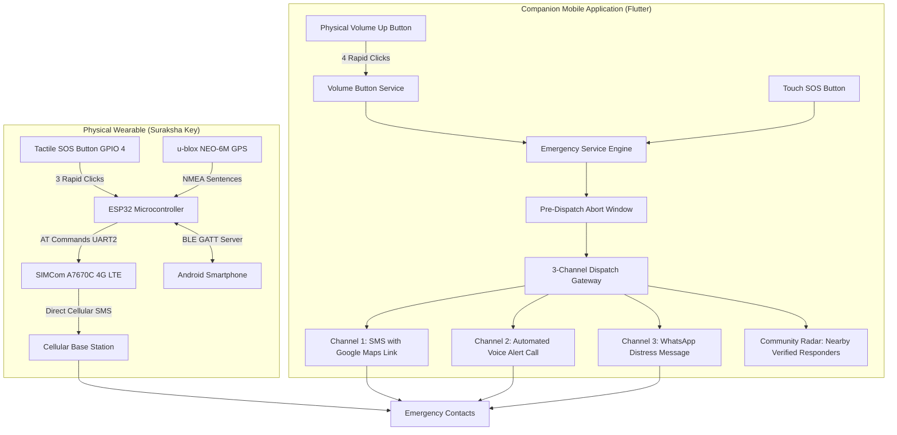

# Aprajita — Autonomous Safety & Emergency SOS System

Aprajita is a mission-critical, dual-redundant emergency safety system designed for women's personal protection. It bridges physical embedded hardware with an offline-first Flutter companion application, providing resilient distress dispatch across multiple redundant pathways even under zero-connectivity or power-constrained conditions.

---

## 🏛️ System Architecture

Aprajita operates across two interconnected domains: an autonomous physical wearable keychain and a mobile smartphone companion application.



---

## ⚡ Core Subsystems & Technical Implementation

### 1. Multi-Channel Emergency Dispatch Engine (`emergency_service.dart`)
* **3-Channel Redundancy**: When an SOS event triggers, the dispatch engine activates three parallel communication channels:
  * **Channel 1 (SMS)**: Dispatches automated distress SMS containing live coordinates and a direct Google Maps link.
  * **Channel 2 (Voice Call)**: Initiates an automated voice phone call to speak synthesized emergency instructions to the recipient.
  * **Channel 3 (WhatsApp)**: Formats and dispatches a rich WhatsApp distress message.
* **Pre-Dispatch Abort Window**: Includes an audio-visual countdown modal (configurable duration) allowing users to cancel inadvertent alerts before dispatch occurs.
* **State Machine Tracking**: Tracks individual recipient delivery statuses (`SUBMITTED`, `DELIVERED`, `FAILED`) with persistent event history.

### 2. Physical Button & Hardware Telemetry (`hardware_service.dart` & `suraksha_esp32_firmware.ino`)
* **3-Press Tactile Keychain Policy**:
  * The physical push button on ESP32 GPIO 4 employs an active-LOW interrupt with internal pullup resistors.
  * Debounced triple-click detection requires 3 deliberate presses within a 1500ms time window to trigger an emergency, completely eliminating accidental pocket activations.
* **Autonomous 4G Cellular Fail-Safe**:
  * The SIMCom A7670C modem handles autonomous GSM communication. If the smartphone battery is depleted, the keychain operates standalone, querying its onboard NEO-6M GPS and transmitting emergency SMS directly over LTE.
* **Non-Volatile Memory (NVS)**:
  * Emergency recipient numbers are synchronized from the app into the ESP32's flash storage (`Preferences.h`), ensuring autonomous offline availability without reliance on a live BLE link.
* **Hardware Diagnostic Engine**:
  * Live monitoring of cellular CSQ signal strength, network registration status (`CREG`), SIM card readiness, and power supply health.

### 3. Screen-Off Physical Trigger (`volume_button_service.dart`)
* **4-Click Volume Up Pattern**:
  * Intercepts Android physical volume keystrokes through native event listeners.
  * Four rapid Volume Up button presses within 2.5 seconds automatically initiate the SOS pipeline, allowing discreet activation from inside a bag or pocket without looking at the screen.

### 4. Dual Location Engine (`location_service.dart`)
* **Hybrid Positioning**: Fuses Assisted-GPS from the mobile device with hardware NMEA coordinates from the u-blox NEO-6M module.
* **Continuous BLE Reverse Sync**: The phone continuously pushes fresh high-accuracy coordinates to the ESP32 every 10 seconds over BLE characteristic `CHAR_PHONE_GPS`.
* **Dynamic Geolocation Links**: Automatically generates standard Google Maps navigation URLs (`https://maps.google.com/?q={lat},{lng}`) with precision timestamps.

### 5. Peer-to-Peer Community Radar (`nearby_service.dart`, `supabase_service.dart`)
* **Haversine Geofencing**: Computes real-time spherical distances between the victim and nearby registered safety network members.
* **Proximity Filtering**: Configurable beaconing radius (1 km to 10 km) to alert local verified community members for immediate physical intervention.

### 6. Design System & Aesthetics (`app_theme.dart`, `app_logo.dart`)
* **Obsidian Palette**: Built on an ultra-dark theme (`#0C0D12` background, `#171A24` cards, `#262B3A` hairline borders, `#E53935` soft crimson accents).
* **Minimalist Brand Emblem**: Monoline vector protective shield integrating an abstract stylized "A" crest.
* **Clean Single-AppBar Architecture**: Unified navigation shell eliminating nested app bars, utilizing modular in-page section headers.

---

## 📁 Repository Directory Structure

```
aprajita_app/
├── android/                         # Android native project, permissions & Gradle configuration
├── assets/
│   └── images/
│       ├── logo.png                 # Scalable minimalist brand emblem
│       └── logo.jpg                 # Fallback launcher asset
├── lib/
│   ├── main.dart                    # Application bootstrap, AppShell & global countdown overlay
│   ├── models/
│   │   ├── contact_model.dart       # Trusted contact entity, E.164 phone validator
│   │   ├── location_model.dart      # GPS coordinates, Haversine spherical distance logic
│   │   ├── nearby_alert_model.dart  # Community radar distress payload
│   │   ├── sos_event_model.dart     # SOS event lifecycle, SMS delivery states
│   │   └── telemetry_model.dart     # ESP32, A7670C CSQ, & NEO-6M satellite telemetry
│   ├── services/
│   │   ├── emergency_service.dart   # Central SOS coordinator, multi-channel dispatch
│   │   ├── hardware_service.dart    # BLE GATT manager & hardware diagnostic simulator
│   │   ├── location_service.dart    # Phone GPS provider, location stream & permissions
│   │   ├── nearby_service.dart      # Peer safety radar & proximity filtering
│   │   ├── storage_service.dart     # SharedPreferences persistence & cache manager
│   │   ├── supabase_service.dart    # Realtime community backend connector & SQL schema
│   │   ├── twilio_service.dart      # REST client for SMS, Voice Call & WhatsApp dispatch
│   │   └── volume_button_service.dart# 4-Click Volume Up hardware trigger listener
│   ├── theme/
│   │   └── app_theme.dart           # Obsidian dark palette, tokens & typography
│   ├── views/
│   │   ├── contacts_view.dart       # Trusted contacts management & ESP32 sync
│   │   ├── hardware_view.dart       # Hardware diagnostics, BLE terminal & simulator
│   │   ├── history_view.dart        # Incident history log & delivery verification
│   │   ├── home_view.dart           # Dashboard, readiness beacon & SOS trigger
│   │   ├── nearby_view.dart         # Community radar & localized distress feed
│   │   └── settings_view.dart       # Gateway configuration & countdown timers
│   └── widgets/
│       ├── app_logo.dart            # Minimalist vector logo badge & custom painter
│       └── sos_countdown_dialog.dart# Pre-dispatch cancellation overlay modal
├── test/
│   └── widget_test.dart             # Phone validation & distance calculation unit tests
├── suraksha_esp32_firmware.ino       # Complete C++ firmware for ESP32 Dev Module
└── pubspec.yaml                     # Dependencies & project metadata
```

---

## 🔒 Security & Privacy Architecture

* **Zero Hardcoded Secrets**: All third-party gateway credentials, phone numbers, and cloud tokens are managed through local device encrypted storage and user configuration.
* **Offline-First Resilience**: All core emergency features operate without external cloud connectivity when paired with the physical hardware module.
* **Accidental Trigger Safeguards**: Hardware debouncing algorithms and software countdown buffers prevent unintentional dispatches.
